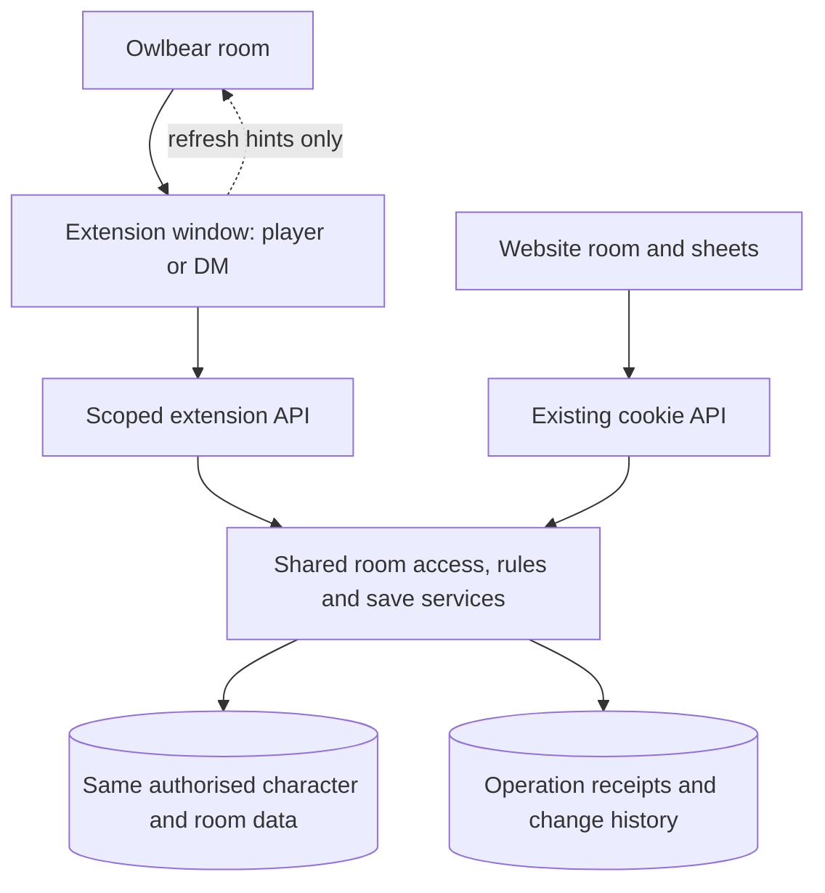
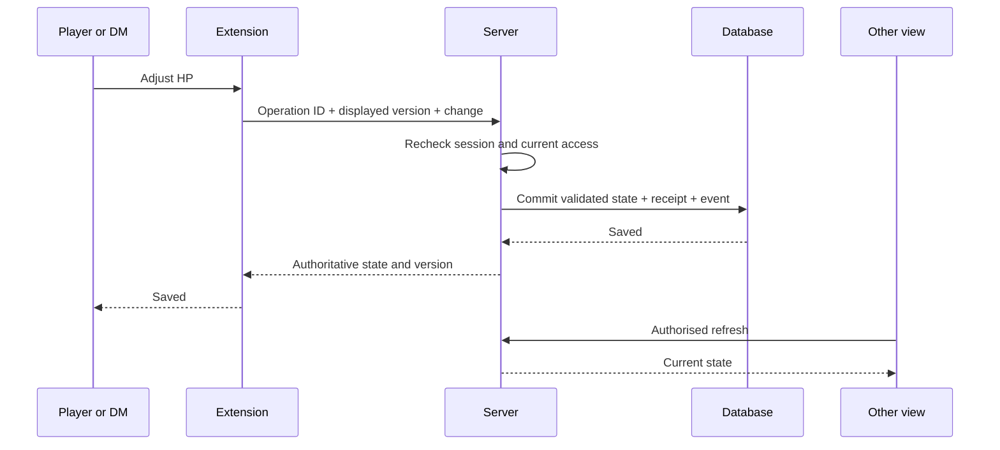

# Owlbear extension: technical plan and first working steps

Project moved on 24 October 2026: current extension planning belongs to [the independent project](../../owlbear-character-sheet/README.md) and its [project boundaries](../../owlbear-character-sheet/docs/ARCHITECTURE.md). This document remains a historical plan; same-repository implementation locations and hosting assumptions below are superseded.

**Date:** 20 October 2026  
**Status:** Planning and source review. No extension implementation or deployment is included.  
**Immediate direction:** Both DM and player views inside Owlbear, developed in small demonstrable steps.

## 1. What we are building first

The first useful version connects an Owlbear window to an existing website game room. The DM can see their available characters and assign them to joined users inside Owlbear. Players can open only their assigned sheets, including the owner's homebrew descriptions. The next steps add HP changes, existing resource trackers and equipment controls, all saved to the same characters the website uses.

The extension is another interface to the website's data. It does not create a second character database or require players to import the DM's packs.

The latest confirmed preference is to include DM controls inside Owlbear from the first useful release. Website-only assignment was suggested and superseded by this decision. The exact layouts below remain proposals for review.

### First scope, later scope

| First useful and playable steps | Later development |
| --- | --- |
| Connect a website account and choose an accessible room | Full embedded permanent character editing and Workshop navigation |
| DM roster, character selection, assign/unassign | Cast action with configured resource spending and Resolved/Countered |
| Player sheet and spell, feature and item descriptions | Integrated turn order, reactions and timed effects |
| Compact window and expanded sheet | Token links, monster statblocks and encounter instances |
| HP, slots, existing trackers, equip/unequip and attunement | Area targeting assistance and DM-triggered enemy saving throws |
| DM delivery of an existing item, after basic saves work | Optional deliberate Dice+ roll buttons |
| Reliable saves, refresh and a basic change history | Rich encounter history, summaries and other conveniences |

Manual spell-slot/resource adjustment comes before a semantic Cast button. This keeps the basic sheet useful without requiring every homebrew spell to have machine-readable mechanics. The agreed casting and encounter features remain on the roadmap.

## 2. Preview of the basic experience

### Connection

```text
Character sheets

Connect your website account
[ Connect in a browser tab ]

After connection:
Room: [ Revalon                         v ]
Signed in as: your website display name
[ Open room ]                       [ Disconnect ]
```

Connection approval displays the account and room explicitly. Existing website registration and persistent room join links continue to work. A user who has not joined a room receives a clear explanation rather than an empty or broken sheet.

### DM compact window

```text
Revalon                 DM      [ Expand ]
[ Characters ] [ Players & assignments ]

Search characters: [                    ]
Fade       Level 6       Assigned: Anna
Lortar     Level 6       Unassigned
Volenta    Level 6       Assigned: Peter

Selected: Fade
HP 34 / 42        AC 16
[ Open sheet ] [ Give item — later step ]

Players & assignments, when selected:
Fade -> [ Anna                         v ]
[ Save assignment ]
```

The DM sees owned, available characters, including unassigned ones. Assignment choices are joined website users, not arbitrary Owlbear display names. The two identity systems are not silently merged. Changing a selection does not save an assignment until Save is pressed.

The roster is the initial DM landing view. Detailed management is behind a tab or disclosure, following the existing preference for a quieter room interface. An expanded selected-character view can follow the website sheet's navigation.

### Player compact window

```text
Fade                    PLAYER [ Expand ]
HP 34 / 42  [ - ] [ + ]      Temp HP 0
AC 16       Spell DC 15

[ Resources ] [ Spells ] [ Equipment ] [ Features ]
Shadow points          4 / 6 remaining
1st-level slots        3 / 4 remaining

Saved                         [ Refresh ]
```

These numbers are illustrative, not a change to Fade. Labels should distinguish remaining uses from spent uses. Spell and item names open readable details; the compact view must not force a separate website visit to read rules. The expanded view grows toward on-site player-view parity.

The DM can inspect a player-style presentation of a selected character. That display choice must not replace server permissions or accidentally enable permanent editing for a player. Clearly distinguish a saved play view from the website's existing simulated, unsaved player preview.

**Interaction budget:** ordinary resource changes should take one action; assignment takes selection plus Save. No extra acknowledgement on every turn. The compact panel must remain practical while moving tokens. Its exact dimensions and dismissal behaviour require an actual Owlbear check.

## 3. What the current system can already provide

These findings come from the local repository, not a fresh production database audit.

| Existing foundation | Evidence | Reuse or limitation |
| --- | --- | --- |
| Room ownership, members and character assignments | `server/models/Room.ts`, `server/routes/rooms.ts` | Reuse the same relationships. DM room reads already include unassigned owned characters. |
| Player sheet and reference access checks | Room character middleware and reference routes | Reuse membership, assignment and ownership checks for every read. |
| Owner-resolved homebrew definitions | `server/lib/workshop-library.ts`, `server/lib/sheet-references.ts` | Resolve the character using its owner's library. Players need no duplicate imports. |
| Validated play changes | `server/lib/play-update.ts`, `shared/rooms.ts` | HP, slots, resources and equipment already have constrained updates. Do not accept a whole replacement character from a player. |
| Stale-write protection | Room play route uses `expectedUpdatedAt` and an atomic version condition | Useful foundation for concurrent edits. This alone does not identify a retry after a lost response. |
| Item delivery protection | `server/routes/characters.ts`, `server/lib/inventory.ts` | Delivery uses a UUID request ID stored as an item's `grantId`; reuse and review it. It is not a universal operation receipt/history system. |
| Sheet display and calculations | Sheet components, `src/lib/character-sheet.ts`, shared item rules | Share calculations, definitions and controls rather than reimplementing AC and resource rules. |
| Quick sheet followed by references | Character store and sheet reference loading | Keep the first useful display small; load descriptions without blocking the whole window. |
| Existing refresh | `src/views/RoomView.vue` | Selected sheets poll roughly every 3 seconds while visible and safe to refresh; roster polls every 15 seconds. This is not instantaneous push. |

Numeric play tracking is a much smaller task than spell automation. Existing descriptive content is sufficient to read a sheet and adjust its trackers. It is not sufficient to infer every spell cost, target, saving throw, temporary modifier or expiry rule automatically.

## 4. Things that could look correct on paper and fail in a real room

| Issue | Current evidence | Required proof before relying on it |
| --- | --- | --- |
| The site refuses to appear inside Owlbear | `vercel.json` currently sets `X-Frame-Options: DENY` on frontend routes | Serve a dedicated extension entry with a narrowly scoped embedding policy; inspect its final deployed response and open it in a test room. |
| Login works in a tab but loops in the extension | Website cookie is HttpOnly, Secure in production, SameSite=Lax; middleware reads the cookie only | Complete a scoped account handoff with third-party cookies blocked. Reload and reopen without depending on the website cookie inside the frame. |
| Embedding the sheet still loads the normal login guard | Current router requires cookie-authenticated `/me` | Give the extension its own entry/auth bootstrap. Do not drop the existing room URL directly into an iframe. |
| Manifest URL returns the website HTML | Vite currently has one normal entry; frontend has a catch-all rewrite | Verify manifest JSON, icons, extension HTML and assets are served as the right files and content types, including direct reloads. |
| A Vercel preview login blocks the frame | Preview deployment protection has not been checked for the intended test deployment | Open the actual HTTPS deployment from a second account/browser before declaring the shell ready. |
| Owlbear GM is mistaken for website DM | Owlbear exposes player ID/role to the client, but our backend has no authenticated Owlbear identity integration | Authorise using the connected website account and current website room ownership. Never trust a client-supplied GM flag. |
| Player assignment uses the wrong identity | Room assignments contain website user IDs | Show joined website users. Any Owlbear identity label is a convenience, never an access grant. |
| Compact and expanded sheets overwrite each other's state | Current Pinia store has one `current` character and room context | Start with one active sheet controller per UI instance; isolate separate windows and guard account/room/character switches. |
| Reopening loses login or causes repeated requests | Frame/storage/background lifecycles have not been exercised | Prove close/reopen, page reload, sleep and room switching in the supported browsers. Clean up listeners and polling. |
| A delayed request displays the previous character's data | Reads and rules are asynchronous | Bind responses to account, room, character and request generation; clear protected state on context changes. |
| A repeated click spends twice | Version checks detect some conflicts, but generic play saves have no durable operation receipt | Identify each operation, reconcile ambiguous outcomes, and prevent duplicate pending actions. |
| Other players look updated, but the website does not | Owlbear broadcasts reach extension contexts, not an ordinary website tab automatically | Keep authenticated polling on both interfaces initially; measure them separately. |
| Embedding regresses the completed loading work | The website already opens saved sheets separately from heavy references | Reuse progressive loading and scoped references; check that the extension does not reintroduce blocking library loads. |

Frame permissions must account for every actual embedding ancestor, not just an assumed parent hostname. Header policy must be sent in the HTTP response. See [MDN: frame-ancestors](https://developer.mozilla.org/en-US/docs/Web/HTTP/Reference/Headers/Content-Security-Policy/frame-ancestors).

SameSite=Lax does not cover normal cross-site iframe requests; third-party cookie restrictions add another concern. The proposed handoff avoids making successful embedded cookie login a prerequisite. See [MDN: Set-Cookie](https://developer.mozilla.org/en-US/docs/Web/HTTP/Reference/Headers/Set-Cookie).

## 5. Proposed architecture



This is the eventual shared architecture. Development starts with a separate test deployment/database and fictional or deliberately selected test data. A preview frontend pointing at the production database is not isolation.

### Extension entry and hosting

Proposed paths, not files that exist today:

- `/owlbear/manifest.json`: static manifest with one toolbar action.
- `/owlbear/index.html`: extension entry for compact and expanded modes.
- A normal top-level `/connect/owlbear` website route for account approval.
- `/api/extension/*`: limited authentication and room operations.

Configure an explicit additional Vite build entry and precise hosting routes. Keep the normal website entry independent. Verify JSON/assets are not rewritten to `index.html`. Apply the embedding exception only to the extension UI. Verify actual Owlbear ancestor origins before selecting the final allowlist.

For the basic version, prefer extension UI and extension API on the same application origin. Do not introduce separate-origin API/CORS complexity without a reason. An iframe running our page does not necessarily send Owlbear as its API request Origin: inspect the real headers. The existing server's cross-site write checks and middleware order must be reviewed for the chosen arrangement; any necessary exception must be limited to authenticated extension endpoints.

The manifest supports an action popover and an optional background page; an expanded interface can use a modal. This establishes available UI surfaces, not their practical comfort or authentication lifecycle. See [Owlbear manifest](https://docs.owlbear.rodeo/extensions/reference/manifest/) and [modal API](https://docs.owlbear.rodeo/extensions/apis/modal/).

### Shared components and state

Keep one implementation of sheet calculations and display rules. Introduce an explicit sheet transport/controller boundary: the website supplies cookie-based requests; the extension supplies its scoped session. Components should not choose permissions based on where they happen to render.

Audit component dependencies before extracting them: Vue Router links, global auth/library stores, window listeners, editing state and the current singleton character store. Render only the selected sheet initially. Switching to a broader view must not create two uncoordinated writers or two high-frequency polling loops.

A same-frame expanded mode is the simplest initial option to prove. If a separate modal works better, treat it as a separate controller that refetches authorised state. Do not pass credentials through URLs or Owlbear broadcasts to initialise it.

## 6. Account connection and permissions

### Proposed handoff

1. The extension creates a short-lived pairing request. The server returns an opaque public request identifier and a separate high-entropy device secret.
2. A user gesture opens a normal website tab showing that request. The user signs in through the existing website flow.
3. The website displays the account, chosen accessible room and requested capabilities. The user approves or cancels this specific connection.
4. The extension polls the pairing status using its device secret in a request body. Approval can be redeemed once for a limited, revocable extension session.
5. Requests carry that session explicitly. The server checks the session, selected room and current permissions again.

The public request ID or a visible confirmation code is not enough to redeem credentials. Pairing needs expiry, bounded polling, rate limits, guessing resistance, single-use redemption and protection against approving an unfamiliar device. Store session/device secrets hashed where applicable. Cookie-based approval retains the website's request-origin protections.

Use opaque revocable sessions or a reviewed equivalent; do not reuse the unrestricted seven-day website JWT as the extension credential. Extension endpoints must require their scoped credential, without silently falling back to a website cookie or a broader owner route. Session lifetime, renewal and browser storage are decisions to validate during the account proof. An in-memory/background approach and partitioned browser storage have different lifecycle tradeoffs. Do not promise “sign in once” before close/reopen and browser privacy checks pass.

Credentials must not enter manifest files, query strings, room/token metadata, shared messages, history or application logs. A background page may help session continuity, but a private authenticated bridge between its UI frames requires its own origin-checked design; Owlbear broadcast is not that bridge.

### Permission matrix

| Operation | DM / website room owner | Assigned joined player |
| --- | --- | --- |
| List room characters | Own available characters, including unassigned | Only their assigned characters |
| Read sheet and relevant owner-resolved definitions | Yes | Only while assigned and a member |
| Change ordinary play resources and equipment state | Yes | On their assigned character, within validated fields |
| Assign/unassign and deliver an item | Yes | No |
| Change permanent choices or Workshop rules | Existing website owner permissions; later embedded UI | No |
| Read complete room change history | Proposed DM access | Scope still to be agreed; no other-player history by default |

Owlbear IDs, token ownership and room metadata do not prove website membership. The first version selects a website room explicitly. A remembered Owlbear-room association can be a convenience later. The SDK's [player ID and role](https://docs.owlbear.rodeo/extensions/apis/player/) are useful UI context, not authenticated claims to our server.

After unassignment/removal, subsequent reads and writes must fail and the UI must clear protected data. Revocation cannot erase information already seen, but it must prevent continued access. Review races between revocation and an in-flight write before the live pilot rather than claiming an initial client-side check solves them.

## 7. API and data contracts

Endpoint names below are proposals. Extract shared domain services underneath existing routes; avoid a second implementation of ownership or homebrew resolution.

| Proposed operation | Contract and server responsibility |
| --- | --- |
| Create/redeem pairing | Short-lived request; one-use approval; no room access before authentication |
| Get extension session | Current website user, selected room, effective capabilities and expiry; minimal profile |
| Get room roster | Same membership rules as current rooms; include room revision for changes |
| Get quick sheet / references | Check current assignment and ownership; preserve character version and library revision |
| Change assignment | Owner only; joined target user; owned character; expected room revision; operation ID |
| Change play state | Narrow existing play schema; expected character version; operation ID; authoritative response |
| Deliver existing item | Owner only; existing item validation and delivery request ID; current character ownership |
| Get operation outcome / history | Authorised scope only; supports reconnect and uncertain responses |

Suggested write envelope:

```json
{
  "operationId": "a-new-uuid-for-this-user-action",
  "expectedUpdatedAt": "the-version-that-was-displayed",
  "changes": { "combat": { "hpCurrent": 29 } }
}
```

Keep the same operation ID when checking/retrying the same action. A different intent gets a new ID. Persist actor, room, target and a canonical payload fingerprint with the receipt. Reject an ID reused with different content. Recheck access even when serving an existing receipt.

For HP, start with the existing explicit new value plus version check. Do not silently replay a stale absolute value over a newer heal/damage change. If a future delta-based damage command is introduced, its exact duplicate/retry semantics need their own contract.

### Persistence and history

Choose the persistence strategy before enabling writes:

- Preferred candidate: mutation, operation receipt and history event committed together in a database transaction. Confirm support and behaviour in the actual test deployment first.
- Alternative: atomically save a bounded outbox/receipt with the changed document, then project durable events with recovery and deduplication. This needs a proven drain/recovery mechanism; it is not automatically simpler.

Do not save the character and then fire-and-forget a separate history insert. A crash would create a change with no reliable record. An in-memory deduplication map is also insufficient across Vercel requests/restarts. Document receipt expiry and what happens to retries after that window.

Item delivery already has `grantId` protection. Review deleted items, payload reuse and receipt retention before presenting that as permanent exactly-once delivery. Preserve this existing safeguard while building a common receipt layer.

History entries should record server time, authenticated actor, source interface, room/character, operation ID, changed fields and before/after values. Group one save into one entry. Start a small DM history list on the website and in the extension; a polished timeline can follow. Avoid full character snapshots or credentials in routine events.

The eventual history requirement covers website and extension changes, including permanent character edits. Instrumenting only extension routes would not fulfil it. Baseline history from the first enabled writes, then cover both current API paths before the live pilot; clearly label any unsupported event types. Workshop publication history, retention, player audience and undo remain separate decisions. Nothing can reconstruct past actors reliably from today's `updatedAt` alone.

## 8. Saving, refreshing and failure behaviour



Only display Saved after server confirmation. Show Saving, Unable to confirm save, Conflict and Disconnected as distinct states. A timeout does not prove a write failed. Check the operation receipt before permitting an automatic resend. Initially disable further conflicting controls while a character write is pending.

| Situation | Intended response |
| --- | --- |
| Two clients change the same sheet | Reject the stale write; fetch current state and explain what changed. Do not silently merge unrelated full snapshots. |
| Connection drops before save confirmation | Reconcile the operation ID on reconnect; do not spend/add again blindly. |
| Read fails or times out | Keep last valid data labelled stale; offer Refresh; do not replace it with an empty sheet. |
| Authentication expires | Disable writes and offer reconnect. Clear protected data if access is revoked. |
| Poll arrives during a save/edit | Preserve pending intent; existing generation/version guards are a foundation. |
| Room, character or account changes | Cancel/ignore previous requests, clear context and start an authorised load. |
| Extension closes during a request | Recover from server state and operation outcome on reopening. Do not depend on a component staying mounted. |
| References are delayed or unavailable | Show basic sheet and a definitions-loading/error state; never silently substitute another pack's same-named rule. |

Begin with visible-window polling, a manual Refresh button and refresh on focus/reopen. Coalesce duplicate reads, use backoff on errors and stop hidden/unmounted polling. Reuse cached references only within the same authorised owner/room context and library revision. Delete protected caches on disconnect/account switch.

An optional Owlbear broadcast can later say “room data may have changed” after a confirmed save. Receivers still fetch authorised state. Never broadcast sheets, credentials or hidden descriptions. [Owlbear broadcast messages are ephemeral](https://docs.owlbear.rodeo/extensions/apis/broadcast/), so reopening/reconnect and fallback polling remain necessary.

### Performance gate

The website loading improvements are already implemented. Recorded checks on 19 October showed saved-sheet opens of 0.60 and 0.78 seconds, while full reference checks took 15.31 and 15.78 seconds separately. These are individual observations, not guarantees or new measurements from this review. See [Sheet loading and spell repair](SHEET_LOADING_AND_REPAIR.md). This plan does not identify a new unresolved website loading defect or require another optimisation project before the basic extension.

Measure separately: quick sheet, definitions, click-to-confirmed-save, confirmed-save-to-other-extension and confirmed-save-to-website. Include cold starts, cached loads, sleep/reconnect and several clients.

Existing 3-second sheet polling implies a wait of up to roughly one polling interval plus request time under normal visible conditions; it is not a guaranteed upper bound. Roster assignment visibility can currently wait for the slower roster refresh. Prioritise assignment refresh on reopen and deliberate refresh before increasing every polling frequency. A later notification channel must reach website users too if fast cross-interface updates are required.

Proposed pilot targets for discussion: most warm basic sheet opens within 2 seconds, saves confirmed within 2 seconds, visible remote updates within 5 seconds. Measure p50/p95, cold outliers and failures before adopting these as promises. Confirm that the extension preserves the existing website's progressive loading behaviour. If minute-long blocking opens recur during future checks, investigate that observed regression using the current timing instrumentation; the historical reports alone are not evidence that it remains unresolved.

## 9. Baby steps and safe stopping points

Each step is a separate, reviewable increment. Completion conditions below describe future verification, not checks already passed.

| Step | Concrete deliverable | Gate before proceeding | Safe stop |
| --- | --- | --- | --- |
| **0 — Review this plan** | Agree on basic DM/player layout and first scope | User can see what the first version does; open choices are explicit | Documentation and previews only |
| **1 — Fictional shell** | HTTPS manifest, one action, fictional player sheet and DM roster; compact/expand | Actual Owlbear loads it, map remains usable, close/reopen behaves; no website/database dependency | Remove the test extension |
| **2 — Connected read access** | Test account pairing, selected test room, both real DM roster and assigned-player read views | Blocked third-party cookies, correct definitions, wrong-account/unassigned access denied, reconnect practical | Read-only test environment |
| **3 — DM assignments** | Assign/unassign inside Owlbear with current joined-user identities | Durable save/receipt approach established; stale room changes handled; revoked player loses subsequent access; website agrees | First useful two-role version, still no resource changes |
| **4 — One resource: HP** | Both roles adjust HP through shared validated saves; minimal change record | Same sheet in two clients, simultaneous change, lost response and reopen all reconcile correctly | A small working play feature |
| **5a — Slots and trackers** | Existing slots, Shadow points, Lucky and other current trackers; rest actions after review | Correct IDs/maxima/recovery, no duplicate spend, no permanent edits through player transport | Ordinary numeric tracking works |
| **5b — Inventory** | Equip/unequip/attune, read full effects, DM gives an existing item | Ring of Protection updates calculated bonuses consistently; duplicate delivery prevented; player cannot create/replace rules | Practical sheet use without a new item builder in Owlbear |
| **6 — Pilot candidate** | Compact/expanded parity review, basic website history, reliable refresh, connection management | Browser/permission/failure/performance gates passed; both API paths produce required events; user approves actual release | One reversible room pilot; website fallback remains available |

**The next implementation task, when authorised, should be Step 1 only.** It should not request live database credentials, alter production embedding/authentication, or begin a spell/turn engine. Its demo must show both roles, including a fictional assignment interaction, to match the user's latest preference.

Steps 2–5 remain separate tasks so we can stop after any one without leaving the current table workflow dependent on unfinished work. No calendar estimate is reliable until the embedding and account-lifecycle proofs are complete.

## 10. Implementation map for later work

| Area | Existing files to inspect/reuse | Proposed change when that step is authorised |
| --- | --- | --- |
| Entry/build | `vite.config.ts`, `vercel.json`, `src/main.ts`, router | Additional extension HTML entry, manifest/assets, narrow frame policy; isolated bootstrap |
| Connection | Auth routes/middleware, request limits, `server/app.ts` | Pairing/session models and extension auth middleware; top-level approval page; explicit revocation |
| Room access | `server/routes/rooms.ts`, `server/models/Room.ts` | Shared access/assignment service used by cookie and extension routes |
| Sheet reads | Character output, sheet references, Workshop resolver | Shared authorised read service and version/revision contract |
| Sheet UI | Character store, RoomView, CharacterSheetView, sheet components | Injectable transport and controlled state ownership; compact role-specific shell |
| Play saves | `server/lib/play-update.ts`, `shared/rooms.ts`, character routes | Shared validated command service, operation receipts and consistent conflict responses |
| Inventory | Inventory helpers, character item route, shared item rules | Reuse delivery and equipment rules; no new duplicate item rules |
| History | Current save routes; no general event system found | Durable events from both interfaces, basic DM reader, access/redaction rules |

Any refactor of shared website code needs a tightly scoped diff and verification under a later implementation task. The test deployment must use separate configuration/database and must not accidentally inherit production environment variables. Public installation/production rollout requires review of the concrete result.

## 11. Keep deeper systems independent

The previous data audit found structured area/save/damage fields in some bundled SRD spells, but imported Orcbrew descriptions are mostly prose. Current normalised monster data does not consistently expose saving-throw bonuses even when raw imported details contain them. Shield's description does not itself supply an executable temporary-AC/expiry rule.

Before deeper automation, inventory the **active** library and add shared, reviewable mechanics profiles at definition level. Do not ask the DM to configure the same rule separately on every character, and do not treat a spell-name match or prose guess as an approved mechanic. The original import-file audit is not a count of currently active, edited production definitions.

| Later feature | Additional prerequisite |
| --- | --- |
| Cast spends a chosen cost | Structured slot/point/innate-use choices, spellcasting source and duplicate-safe cast commands |
| Shield / other temporary effects | Active effect model, explicit modifier and expiry anchor, reaction use outside own turn |
| Turn tracker | Authoritative encounter clock, ordered combatants, permissions, concurrency and correction rules |
| Fireball targeting assistance | Reviewed area/range metadata, map units and token footprints, DM corrections and hidden-information rules |
| Roll enemy saves | Linked per-creature statblocks, actual save bonuses, spell DC/source, resolved cast and durable roll-batch identity |

Preserve the approved workflow: Cast does not automatically roll player spell dice; Resolved/Countered remains explicit; reminders stay passive. Later enemy saves use **one DM “Roll enemy saves” button after resolution**. Forge! and Dice+ can remain in use during the basic extension work. Neither integration is a dependency for opening sheets or saving HP.

## 12. Evidence, open choices and handoff

### What was checked for this document

- Local build/hosting, auth/router, room/assignment, character store, play validation and inventory delivery code.
- Official Owlbear manifest, action, modal, player and broadcast documentation; browser cookie/frame guidance.
- Existing planning artifacts and confirmed decisions from the conversation.
- A read-only live response-header request was attempted, but DNS resolution failed in this environment. The frame-blocking finding is therefore verified from local configuration, not a captured current production response.

No real Owlbear frame, account handoff, resource mutation, cross-client latency or production header behaviour was verified during this planning task. No application tests were run and no deployment/settings/data changes were made.

### Decisions to revisit at the relevant step

1. Approve compact DM/player layouts using the fictional shell; keep the broad view expandable.
2. Choose session lifetime and a browser-proven persistence/renewal method after the connection proof.
3. Choose atomic receipt/history persistence after checking the test database capabilities.
4. Set supported browsers/displays and measured performance acceptance targets before a pilot.
5. Agree history retention and any player-visible history; DM access is the starting proposal.
6. Decide which permanent DM editing tools should be embedded after basic room/play controls. A full Workshop is not assumed in the first steps.

### Related planning artifacts

These existing files are local design history, not functioning integrations:

- [Overall extension roadmap](C:/Users/PC/.codex/visualizations/2026/10/17/01a14b8c-9c21-7ff0-81a5-3ba2f85c5819/owlbear-extension-roadmap.md)
- [Character/DM interface prototype](C:/Users/PC/.codex/visualizations/2026/10/17/01a14b8c-9c21-7ff0-81a5-3ba2f85c5819/owlbear-character-extension.html)
- [Encounter interaction prototype](C:/Users/PC/.codex/visualizations/2026/10/17/01a14b8c-9c21-7ff0-81a5-3ba2f85c5819/owlbear-encounter-flow.html)
- [Area targeting prototype](C:/Users/PC/.codex/visualizations/2026/10/17/01a14b8c-9c21-7ff0-81a5-3ba2f85c5819/owlbear-area-targeting.html)
- [Earlier data-readiness audit](C:/Users/PC/.codex/visualizations/2026/10/17/01a14b8c-9c21-7ff0-81a5-3ba2f85c5819/encounter-data-readiness.md)

This document governs the proposed immediate implementation order. In particular, basic sheets and manual resource tracking can precede the deep mechanics audit, and DM assignments belong in the first useful release. The larger roadmap retains the later approved directions.
