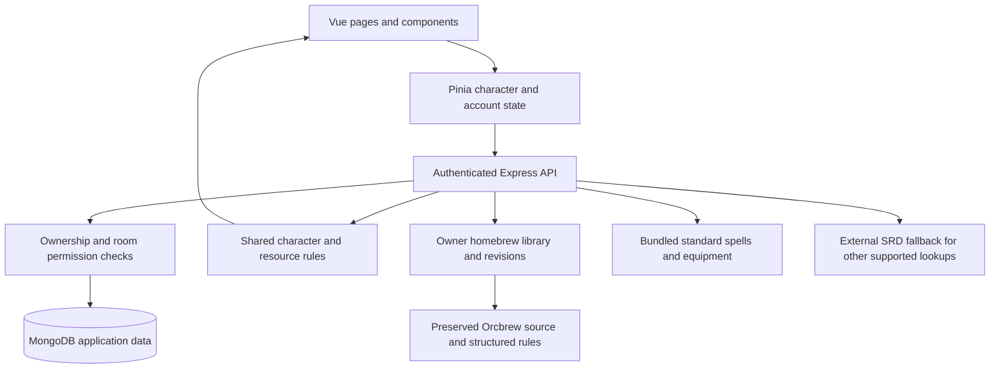
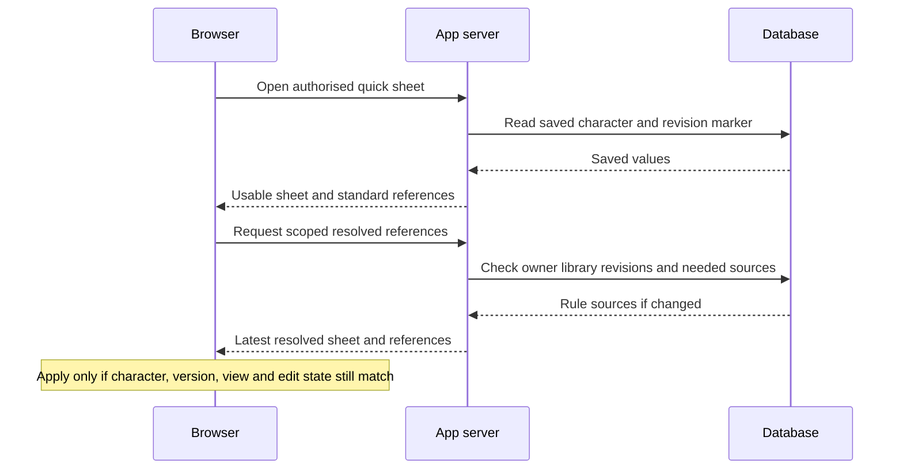

# Codex of Heroes: project history and learning guide

**Prepared for you, Sir · 19 October 2026 · D&D 5E character and homebrew site**

## How to use this guide

This is the story of how the project developed: the problem at each stage, what
changed, why we chose that solution, and what you can learn from it. It is also an
index for future conversations. You can say, for example:

> “Let’s discuss Step 20. Explain how a character opens quickly, then walk me
> through the code a little at a time.”

You do not need to understand every technical term on the first reading. Start
with the chronology, use the glossary when needed, and return to one step at a
time. The learning questions are prompts for our discussions, not homework that
must be completed before continuing.

### What the history can establish

- The **order of requests and decisions** comes from our conversation.
- The **current implementation** is checked against the repository and its
  existing technical notes.
- The initial app and plan checkpoint have Git dates of **17 October 2026**.
  Several builder, import and Workshop notes are dated **18 October**; hosting,
  playtest and later refinements are recorded across **18–19 October**.
- Most intermediate work was committed together on 19 October. The 25 steps
  below describe development stages; they are **not 25 historical commits**.
- A request can start in one step and receive its final solution later. Where
  that matters, this guide points to the follow-up.
- Some earliest messages mention a problem or removal without retaining enough
  detail to identify it. This guide does not invent an explanation for those
  exchanges. The exact earlier OpenCode session transcript was not among the
  materials used to prepare this guide.

Old planning passages are historical evidence, not a complete description of the
current app. For example, parts of `PLAN.md` still describe a modal character
creator, a smaller homebrew scope, and a proposed SRD storage approach that the
later implementation expanded or handled differently.

## Contents

1. [The project in one page](#the-project-in-one-page)
2. [Chronology at a glance](#chronology-at-a-glance)
3. [The 25 development steps](#the-development-steps)
4. [How the current system fits together](#how-the-current-system-fits-together)
5. [Four useful examples to study](#four-useful-examples-to-study)
6. [Decisions and limits we should revisit](#decisions-and-limits-we-should-revisit)
7. [Suggested learning route](#suggested-learning-route)
8. [Glossary](#glossary)
9. [Code and documentation map](#code-and-documentation-map)
10. [Git history and how to review it](#git-history-and-how-to-review-it)
11. [Evidence and validation](#evidence-and-validation)

## The project in one page

### Where we started

The starting point was a local website for creating and storing D&D characters,
with accounts, a character sheet, basic calculations, an SRD browser, and a
development database. The original implementation already used Vue and
TypeScript in the browser, Express on the server, and MongoDB for storage.

### What we were trying to achieve

Your requests gradually defined a more specific product:

- Bring your existing Dungeon Master’s Vault characters and Orcbrew content
  into the site.
- Make character creation detailed but easy to navigate.
- Make sheets compact, readable, and convenient during actual play.
- Keep permanent character editing under the DM’s control while allowing
  players to manage their own play resources.
- Author classes, subclasses, races, and items inside the site.
- Apply supported content revisions to existing characters while protecting
  their play state and personal choices.
- Run a public site with private rooms, account-based access, and persistent
  invitation links.
- Make the implementation understandable enough that you can learn from it.

### The most important design distinction

The site now separates three things that initially looked like one problem:

| Layer | Example | What it answers |
| --- | --- | --- |
| Content definition | A class, race, spell, feat or item template | “What are the rules?” |
| Character choices | Which class, spells, feats and items a character has | “What did this player choose or receive?” |
| Play state | Current HP, used slots, spent points, equipment activation | “What is happening during the session?” |

A Workshop edit should change supported rules without casually resetting HP.
A player spending a spell slot should not change the class’s slot progression.
An item can be owned without its magical effects being active. Many later
features follow directly from these distinctions.

## Chronology at a glance

| Step | Development stage | Main reason it happened |
| --- | --- | --- |
| [01](#step-01) | Inherited app and plan review | Establish what already existed and what could be trusted |
| [02](#step-02) | Runtime and development environment | Resolve the old Node version and local setup mismatch |
| [03](#step-03) | Orcbrew import and export | Preserve your existing homebrew files |
| [04](#step-04) | Orcbrew integration and overlaps | Make imported definitions usable without confusing duplicates |
| [05](#step-05) | Dedicated character builder | Provide detailed creation with clear navigation |
| [06](#step-06) | Themes, spell browsing and allowances | Improve readability and explain selection limits |
| [07](#step-07) | DMV character-link import | Avoid rebuilding existing characters manually |
| [08](#step-08) | Sheet structure and editing boundaries | Separate permanent changes from everyday play |
| [09](#step-09) | Compact features, equipment and references | Reduce scrolling and expose useful rules |
| [10](#step-10) | Custom casting and resource progression | Make Fade’s setup understandable and reusable |
| [11](#step-11) | Shared class rules, party imports and champions | Generalise character-specific fixes to the class and table |
| [12](#step-12) | Class and subclass Workshop drafts | Make complex content authoring possible |
| [13](#step-13) | Workshop publication, revisions and exports | Update existing characters without destroying play state |
| [14](#step-14) | Private-room design and permissions | Let invited players use assigned DM-owned characters |
| [15](#step-15) | Public hosting and account migration | Move the project off one local computer |
| [16](#step-16) | Shared content and Compendium items | Ensure players can read their rules and find standard items |
| [17](#step-17) | Race builder and missing racial grants | Correct the content type behind missing traits |
| [18](#step-18) | First loading and editing improvements | Address very slow sheets and difficult spell repair |
| [19](#step-19) | Inventory rule resolution and compact layout | Make imported weapons and item effects work visibly |
| [20](#step-20) | Progressive loading and DM Player view | Make sheets usable before heavy references finish loading |
| [21](#step-21) | Automatic feat resource trackers | Turn feats such as Lucky into usable counters |
| [22](#step-22) | Summary, resource descriptions and companion access | Apply the next round of table feedback |
| [23](#step-23) | Item creation, delivery and live template updates | Give players usable loot during a session |
| [24](#step-24) | Base item types, tags and detailed filtering | Make authored equipment easier to create and find |
| [25](#step-25) | Git checkpoints and learning documentation | Make the accumulated work reviewable |

## The development steps

<a id="step-01"></a>
### 01 — Establishing the starting point

**Trigger.** You asked for an audit of the plan based on the previous OpenCode
work, then asked for another audit when that plan changed.

**What existed.** The original full-stack app supplied registration and login,
character storage, sheet tabs, basic D&D calculations, a Compendium and a local
SRD setup. It was a foundation rather than the finished product you wanted.

**Why the review mattered.** A plan can contain assumptions that the code or
tools do not support. For example, the early notes needed to distinguish API
coverage from the amount of content present in that API. Background and feat
routes existed, but their seeded SRD coverage was small.

The 17 October plan checkpoint also recorded an experiment showing that a test
spell could be served from the local SRD database. That established a possible
integration path. It did not require every later homebrew feature to be inserted
into the upstream SRD collections; the developed app uses its own authenticated
content store and normalised imported catalogues.

**Where to look.** [PLAN.md](../PLAN.md), especially the original go/no-go result;
the original app commit `f61f41b` and plan correction `dde40b8`.

**Learning question.** What is the difference between an assumption, a small
experiment that verifies it, and a complete implementation?

<a id="step-02"></a>
### 02 — Understanding the Node and local-service setup

**Trigger.** You noticed a log reporting Node `v20.15.0` and asked why Node 26
was not in use.

**What changed or became clearer.** We distinguished the Node version installed
on a machine, the version selected by a particular terminal, the version the
project asks for, and the version used by the hosting provider. These can differ.
The repository now declares Node `>=22.12.0`; `.nvmrc` contains `24`. The recent
deployment commands ran locally with Node 26.8.2, while the configured Vercel
runtime was recorded as Node 24.

**Why.** The old terminal version was below the project’s current minimum.
Selecting a newer version in another terminal does not automatically change
an already running terminal or a remote deployment environment.

Local development also uses separate services: the frontend, the app backend,
and Docker services for MongoDB, Redis and the SRD API. The Vite development
proxy directs requests to the appropriate local service. The public deployment
later introduced a different service arrangement in [Step 15](#step-15).

**Where to look.** [package.json](../package.json), [.nvmrc](../.nvmrc),
[vite.config.ts](../vite.config.ts), [docker-compose.yml](../docker-compose.yml).

**Learning question.** Why can a project work in one terminal but fail in another
even though both terminals are on the same computer?

<a id="step-03"></a>
### 03 — Bringing Orcbrew files into the site

**Trigger.** You supplied `Blacky's Book of Shadows2.orcbrew` and asked for import
and export of that file type.

**What changed.** The server gained an EDN reader and Orcbrew import/export
handling. EDN is the data notation used inside these files; changing a filename
extension does not turn the contents into ordinary JSON.

**Why preservation came first.** We needed to keep your source content even
when the site did not yet understand every rule. The original source is retained
for export, including details that are outside the supported structured model.
An untouched imported file can be downloaded with its original source preserved.
Authored Workshop changes later use a more deliberate editing path.

The parser treats the file as data. It does not execute arbitrary Clojure code
or assume every embedded expression is a working site rule. File-size and parse
validation help turn malformed input into a clear import problem.

**Where to look.** [edn.ts](../server/lib/edn.ts),
[orcbrew.ts](../server/lib/orcbrew.ts),
[OrcbrewPacks.vue](../src/components/OrcbrewPacks.vue).

**Learning question.** Why is “we can read and preserve this file” a different
achievement from “we can automatically apply every rule in this file”?

<a id="step-04"></a>
### 04 — Making imported content usable and handling overlaps

**Trigger.** You asked for the Orcbrew content to integrate with the existing
system, then supplied `all-content.orcbrew` and stressed that overlaps should
not cause problems.

**What changed.** Parsed entries became normalised catalogues for spells,
classes, races, subclasses, feats and other reference types. The Compendium and
character workflows could consume supported fields rather than merely list
uploaded files.

**Why names were not enough.** Two spells can share a name while containing
different rules. The same definition can also appear in two files. The system
therefore distinguishes an exact reimport, an identical definition from another
source, and a genuinely different version.

Exact imports are idempotent: repeating the same operation does not add another
copy. Identical definitions can share an identity while retaining provenance,
meaning their source information. Different versions retain distinct identities
and source labels. Older references can survive through aliases. Unsupported
sections remain available as reference data.

**Where to look.** [orcbrew.ts](../server/lib/orcbrew.ts),
[orcbrew-library.ts](../server/lib/orcbrew-library.ts),
[srd.ts](../src/lib/srd.ts), [content.ts](../server/routes/content.ts).

**Learning question.** How can we remove duplicate content without accidentally
merging two different homebrew versions?

<a id="step-05"></a>
### 05 — Building a dedicated character-creation screen

**Trigger.** You supplied Dungeon Master’s Vault’s character builder as the main
inspiration and asked for similar detail with easier navigation.

**What changed.** Character creation moved into its own route,
`/characters/new`, with freely navigable sections and a live summary. The builder
handles ancestry, class and level, abilities, background, training, spells,
equipment, identity, advancement choices and review.

**Why.** A small creation modal was too restrictive once imported content and
detailed choices were involved. Separating the process into sections makes it
possible to revisit a decision without restarting the whole character.

The builder supports standard array, point buy and manual scores. It derives
supported class and ancestry information and stores a local draft scoped to the
account. The draft is removed only after character creation succeeds. This
protects work when a save fails or the user changes sections.

**Where to look.** [CharacterCreationView.vue](../src/views/CharacterCreationView.vue),
[useCharacterBuilder.ts](../src/composables/useCharacterBuilder.ts),
[character-builder.ts](../src/lib/character-builder.ts),
[creation components](../src/components/creation).

**Learning question.** Which values should be saved as choices, and which should
be calculated from those choices?

<a id="step-06"></a>
### 06 — Improving appearance and making spell limits understandable

**Trigger.** You liked the builder but found spell browsing awkward, the Add
button difficult to reach under long descriptions, and the preview too small.
You then requested deeper colour customisation, a near-black/red combination,
and visible spell/cantrip allowances with an override.

**What changed.** Spell lists and descriptions gained independent scrolling and
a persistent Add action. Summary text became more readable. Appearance settings
grew into site-wide themes, accent palettes, a custom colour, surface-colouring
strength and reading size. Obsidian/Crimson became the default; other palettes,
including the green option, remain available.

Spell selection distinguishes cantrips, known spells or spellbook entries, and
prepared spells. Supported progression rules supply the allowance. Upper limits
are enforced unless the explicit override is enabled. Existing excess choices
are preserved for review rather than silently deleted.

**Why.** A spell count is useful only when the user knows what it counts. A
wizard’s spellbook and prepared list are not the same limit. Homebrew needs an
escape hatch because its rules can differ from the standard progression.

**Where to look.** [useBuilderAppearance.ts](../src/composables/useBuilderAppearance.ts),
[spell-selection.ts](../src/lib/spell-selection.ts),
[SpellPicker.vue](../src/components/pickers/SpellPicker.vue).

**Learning question.** How do we offer customisation and rules enforcement
without making unusual but valid characters impossible to enter?

<a id="step-07"></a>
### 07 — Importing a character from a DMV link

**Trigger.** You supplied an existing DMV character link and asked whether the
site could import it directly, with a workaround if necessary.

**What changed.** The dashboard gained a public-link importer with a preview.
The server reads supported public character data, converts selections, matches
available rules, and reports unresolved information. EDN/JSON character-data
uploads provide a fallback.

**Why a preview mattered.** A source character may depend on homebrew that has
not been imported or cannot be represented exactly. HP, AC, features and spell
references should be reviewable before creating the new sheet.

Import creates a separate character owned by the signed-in account. It retains
the original data for later inspection and export. The remote reader restricts
the accepted host and path, refuses redirects, and bounds request size and time.
Those checks prevent a character-link field from becoming an unrestricted way
to make the server access arbitrary addresses.

**Where to look.** [CharacterLinkImport.vue](../src/components/CharacterLinkImport.vue),
[dmv-import.ts](../server/lib/dmv-import.ts),
[character-import.ts](../server/routes/character-import.ts).

**Learning question.** Why should importing external data create warnings and
retain the original instead of pretending the conversion is exact?

<a id="step-08"></a>
### 08 — Separating a playable sheet from permanent editing

**Trigger.** Your session-feedback notes led to questions about the permanent
left summary, daily play controls, class resources, feature presentation, and
feats versus Ability Score Improvements.

**Your decisions.** Keep identity and important statistics visible: name, race,
class, level, XP controls, abilities, proficiency bonus, AC, passive perception,
maximum HP and training. Keep play controls usable outside Edit. Add automatic
trackers plus custom trackers. Track feat choices against advancement
opportunities, with an explicit override for exceptions.

**What changed.** The sheet gained a dedicated editing area and clearer summary,
features, spell and resource components. Editing permanent rules became a
different activity from spending slots, changing current HP or equipping gear.

**Why.** A session interface should make frequent actions easy while protecting
the character’s underlying choices. This distinction later became the server’s
DM/player permission boundary in [Step 14](#step-14).

**Where to look.** [CharacterSidebar.vue](../src/components/sheet/CharacterSidebar.vue),
[CharacterEditTab.vue](../src/components/sheet/CharacterEditTab.vue),
[CombatTrackers.vue](../src/components/sheet/CombatTrackers.vue),
[advancements.ts](../src/lib/advancements.ts).

**Learning question.** Why does “can use the sheet” not have to mean “can edit
every field on the character”?

<a id="step-09"></a>
### 09 — Making the sheet compact and its references accessible

**Trigger.** Large tracker panels and feature lists required too much scrolling.
Imported weapon training lists were bloated. Dropdowns were hard to read. The
Hide action could make combat features difficult to recover. You also requested
equipment categories, attack/AC details, feat descriptions and independent
feature columns.

**What changed.** Resource panels and layouts became tighter. Class combat
features and feats received separate presentation. Feature expansion in one
column stopped stretching unrelated rows in the other. Dropdown colours and
text became clearer. Feature pinning remained useful without relying on the old
hide behaviour; legacy hidden flags are ignored by combat suggestions.

Very long imported weapon-training lists are compacted into simple/martial
weapon group labels. Inventory presentation separates weapons, armour, treasure
and other equipment, with attack and AC information where supported. Feat names
offer readable references. Popup dismissal was refined so a closed dialog does
not leave an unwanted hover preview behind.

**Why.** The aim was faster scanning during play, while retaining full rules
behind an intentional expansion or popup. Visual density and missing information
are separate problems; compacting the page should not remove the explanation.

**Where to look.** [CombatFeatures.vue](../src/components/sheet/CombatFeatures.vue),
[FeatReference.vue](../src/components/sheet/FeatReference.vue),
[useIndependentColumns.ts](../src/composables/useIndependentColumns.ts),
[weapon-proficiencies.ts](../shared/weapon-proficiencies.ts).

**Learning question.** When does a two-column grid help, and when do shared row
heights make it harder to read?

<a id="step-10"></a>
### 10 — Turning Fade’s custom progression into explicit rules

**Trigger.** Fade’s imported custom class had incomplete features, and the editor
made it unclear how many slots or shadow points to enter. You explained that he
gains one shadow point per level and casts with Constitution.

**Your decisions.** “Basic spellcasting” means full-caster progression. At level
6, the confirmed ordinary slot totals are 4 first-level, 3 second-level and 3
third-level slots. Shadow points recover on a long rest.

**What changed.** Casting progression, casting ability, class/character level,
resource scaling and recovery became explicit settings with level-aware totals.
The editor could show what the selected progression produces rather than asking
the DM to guess unexplained numbers.

**Why.** A total such as six points is a snapshot. A rule such as one point per
class level can continue working after the character levels up. Similarly,
Constitution as the casting ability is separate from how many slots the class
receives.

**Where to look.** [character-progression.ts](../shared/character-progression.ts),
[SpellSlotEditor.vue](../src/components/sheet/SpellSlotEditor.vue),
[ResourceEditor.vue](../src/components/sheet/ResourceEditor.vue).

**Learning question.** What is the difference between storing today’s answer
and storing the rule that can calculate tomorrow’s answer?

<a id="step-11"></a>
### 11 — Generalising custom rules to the class and the party

**Trigger.** You pointed out that shadow points belong to Revenant Shadow, not
only to Fade. You requested more character imports and a Shadow Champions
reference area. Volenta’s Rift Dice and bonus casting resource needed their own
interpretation.

**What changed.** The class recognises the Revenant Shadow/Shadow Revenant name
variants and supplies the confirmed full progression and CON casting default.
Shadow points scale with class level. Companion support follows the eligible
class instead of a hard-coded character name. Other requested party imports
expanded the examples against which imported content was understood.

**Your clarifications.** Volenta’s Rift resource and separate Riftborne bonus
slot recover on a long rest. Step through the Shadows and Mantle of Darkness
also recover on a long rest. You requested the original 2014-era Tasha’s and
Xanathar’s versions for the missing Summon Undead and Gust definitions. These
are recorded choices about the table’s content, not guesses based only on a
similar feature name.

**Why.** A character-specific patch fixes one sheet. A class or race rule can
apply to all matching existing and future characters. Free or additional casting
resources remain separate from ordinary slots so their usage is visible.

**Where to look.** [class-rules.ts](../shared/class-rules.ts),
[character-resources.ts](../shared/character-resources.ts),
[ShadowChampions.vue](../src/components/ShadowChampions.vue).

**Learning question.** How do we recognise when a one-character fix should
become a reusable rule?

<a id="step-12"></a>
### 12 — Designing the class and subclass Workshop

**Trigger.** You asked for a custom-content creation tool, using DMV as a
reference, and required confirmation of major decisions. You selected classes
and subclasses first and approved the preview before proceeding.

**What changed.** The Homebrew Workshop gained structured drafts with sections
for identity, training, progression, spellcasting, resources, features/choices and
review. A level preview shows the result at levels 1–20. Drafts are kept locally
per account, separate from character-creation drafts.

**Why a structured editor was necessary.** A paragraph describing a class can
be read by a person, but the program needs explicit values to calculate slots,
resources and feature unlocks. Structured fields describe the parts the site can
automate; imported unknown fields remain attached for reference.

The preview is an opportunity to inspect a rule before applying it to saved
characters. It does not make every imported selection or external rule expression
automatically executable.

**Where to look.** [HomebrewWorkshopView.vue](../src/views/HomebrewWorkshopView.vue),
[WorkshopEditor.vue](../src/components/workshop/WorkshopEditor.vue),
[WorkshopPreview.vue](../src/components/workshop/WorkshopPreview.vue),
[homebrew-workshop.ts](../shared/homebrew-workshop.ts).

**Learning question.** How does a structured form turn content into data that
both a person and a program can understand?

<a id="step-13"></a>
### 13 — Publishing rules and updating existing characters

**Your decisions.** Allow editing an imported pack, with the option to save to
another or a new pack. Apply saved changes to existing characters automatically.
Preserve play state and player choices where possible, and flag conflicts.
Support DMV-compatible Orcbrew and a complete site backup.

**What changed.** Published rules gained stable IDs, revisions and previous
identities. Managed EDN fields can be edited while unrelated source content is
preserved. Rule changes are reconciled against the character’s previous rules
and its current values.

**Why reconciliation matters.** Replacing a whole character with a fresh class
preview would reset information unrelated to the class edit. The reconciliation
process updates supported grants and totals, retains personal edits and choices
where possible, and raises review notices when it cannot safely decide.

The server uses version checks to avoid overwriting concurrent play actions.
Busy sheets can require a later refresh or retry. If a source becomes unavailable,
the saved character-bound rule snapshot remains available with a notice.

Orcbrew exports use standard fields where possible. Site-specific automation can
also require a namespaced extension and readable fallback descriptions; an
external website is not guaranteed to run that extension. Native backups preserve
more site detail. Backup restoration was added later with the public migration.

**Where to look.** [workshop-character.ts](../shared/workshop-character.ts),
[workshop-library.ts](../server/lib/workshop-library.ts),
[workshop-pack.ts](../server/lib/workshop-pack.ts),
[WorkshopPublish.vue](../src/components/workshop/WorkshopPublish.vue).

**Learning question.** How can changing a rule update a character while keeping
the player’s current HP and spent resources meaningful?

<a id="step-14"></a>
### 14 — Designing private rooms before building their interface

**Trigger.** You wanted to create a session, invite users and assign imported
characters. You reserved control over the interface layout and asked to iterate
over ideas before implementation.

**Your decisions.** A session means a persistent private game room. The DM keeps
character ownership and permanent editing. Assigned players can read the whole
sheet, including spells, equipment and features, and manage play resources. You
selected the roster-and-sheet proposal. Invitations should use a persistent
joining link rather than an automatically expiring one-use link.

**What changed.** Rooms gained membership, DM ownership, character assignments
and joining links. Joining a room does not by itself reveal every character;
assignment controls which sheets a player receives.

**Why the server must enforce this.** Hiding Edit in the player interface is
helpful but insufficient. A server must also reject requests that attempt to
change class rules, ability scores or item definitions through a play update.
The allowed play fields are deliberately narrower than the full character model.

**Where to look.** [rooms.ts model](../server/models/Room.ts),
[rooms.ts routes](../server/routes/rooms.ts),
[shared/rooms.ts](../shared/rooms.ts),
[play-update.ts](../server/lib/play-update.ts).

**Learning question.** What is the difference between being signed in, being a
room member, and having permission to use a particular character?

<a id="step-15"></a>
### 15 — Hosting the public site and moving your library

**Trigger.** You requested Vercel deployment and chose the free setup after
asking for an explanation of the hosting options.

**What changed.** Vercel serves the built frontend and the Express backend.
MongoDB Atlas supplies the hosted application database. Production configuration
uses hosted secrets and rejects the development authentication default.

**Your decisions.** Use a dedicated Atlas project and an app database user
restricted to read/write access on `dnd_site`. Allow the network connectivity
required by the selected free deployment arrangement, with authenticated,
encrypted database connections. Create a fresh public DM account and restore
your existing content into it rather than publish the shared demo account.

The transfer restored six characters and two content entries into the new
account. Backups and migration paths preserved source content and IDs while
mapping ownership to the new DM. Credentials were not part of the content backup.

**Why setup required your involvement.** Service login, account creation and
private credential entry required actions in your accounts. The repeated login
and saved-password steps were provisioning work, not features players must
repeat to use the site.

This is a different deployment model from the local Docker stack. The browser
uses the site’s own `/api` routes, keeping frontend and app requests under the
same public origin.

**Where to look.** [PUBLIC_HOSTING.md](PUBLIC_HOSTING.md),
[vercel.json](../vercel.json), [app.ts](../server/app.ts),
[env.ts](../server/env.ts), [library-restore.ts](../server/routes/library-restore.ts).

**Learning question.** Which parts of a local application must change when it
becomes a public service used by several accounts?

<a id="step-16"></a>
### 16 — Sharing character rules and expanding the Compendium

**Trigger.** You asked whether your players needed their own Orcbrew imports,
whether resources and new items would update during play, and why the Compendium
lacked standard items. You then requested magic-weapon, armour and damage filters.

**What changed.** Assigned-sheet references are resolved from the owner’s
library and supplied through authorised room routes. Players can therefore read
the supported rules for their assigned character without separately importing
the owner’s pack. The Compendium gained standard equipment and magic-item
browsing, followed by classification-based filters.

**Why a filter index was useful.** Fetching every full magic-item description
just to decide which items are swords would be wasteful. A small index records
categories, permitted base forms and relevant damage information.

Generic magic weapons can match several physical forms. A combined weapon/damage
filter must evaluate the same form rather than combine unrelated matches. Spell
damage and resistance are not treated as a weapon’s attack damage.

The request for live resource/item visibility continued through the loading and
item-delivery work. The current room refresh behaviour is explained in
[Steps 20](#step-20) and [23](#step-23); it uses polling, not instant push.

**Where to look.** [sheet-references.ts](../server/lib/sheet-references.ts),
[CompendiumView.vue](../src/views/CompendiumView.vue),
[magic-item-filters.ts](../src/lib/magic-item-filters.ts),
[MAGIC_ITEM_FILTERS.md](MAGIC_ITEM_FILTERS.md).

**Learning question.** Why can a player receive the rules they need without
receiving the owner’s entire raw content library?

<a id="step-17"></a>
### 17 — Correcting missing racial features with a race builder

**Trigger.** Missing Shadow Touched features first appeared to be a subclass
problem. You corrected the request: this needed a race builder. You also asked
for the Dawnwalker-related character and other affected races to be checked.

**Your decision.** Support a full race builder, applying traits and trackers
automatically while flagging ability-bonus changes for review. You confirmed
level 1 as the acquire level for Shadow Touched’s listed spells.

**What changed.** The Workshop gained race traits and choices, movement, size,
vision, languages, training, ability bonuses, defensive properties and innate
spell grants. Imported race definitions can be resolved for existing characters
without requiring their first manual Workshop publication.

**Why ability scores need special handling.** If an imported score already
includes a racial bonus, adding the new bonus again would inflate it. Existing
scores remain intact and changed bonuses are flagged. Innate racial spells also
stay distinct from class spell choices and ordinary slot progression.

Some imported casting limits and the natural-armour formula remain review
questions. The level clarification did not answer every casting or armour rule.
The technical notes identify Dawnwalker Vampire as the race on Volenta’s sheet;
her wizard class is a separate definition.

**Where to look.** [RACE_WORKSHOP.md](RACE_WORKSHOP.md),
[RaceWorkshopEditor.vue](../src/components/workshop/RaceWorkshopEditor.vue),
[workshop-race.ts](../shared/workshop-race.ts).

**Learning question.** How do we update a derived bonus without applying it twice
to a value imported from another website?

<a id="step-18"></a>
### 18 — First response to slow sheets and difficult spell repair

**Trigger.** Playtesting revealed sheets that could take nearly a minute to
open, a busy DM room, and missing spell definitions that were awkward to replace.
Counterspell was a clear example of an unresolved reference with an obvious
standard counterpart.

**Your layout decision.** Use a top character selector and collapse management
and character-summary controls. A later feedback pass moved Summary into its own
first tab.

**What changed.** Character screens stopped requesting several complete
homebrew catalogues and instead requested a character-scoped bundle. Needed
standard spell definitions were supplied locally. Heavy editor-only lists load
when the owner enters Edit. Server library work gained revision-aware caching
and shared in-progress requests.

Spell repair became a clear replacement workflow. Replacing a definition keeps
prepared state and avoids duplicate IDs. A uniquely identifiable missing standard
reference can show a labelled fallback. A hash without a readable identity cannot
tell us which spell to substitute. Valid homebrew is not automatically replaced
just because an SRD spell shares its name.

**Why.** Data volume, repeated work and ambiguous references were separate
causes. A visual loading spinner alone could not solve them.

**Where to look.** [SHEET_LOADING_AND_REPAIR.md](SHEET_LOADING_AND_REPAIR.md),
[useSheetLibrary.ts](../src/composables/useSheetLibrary.ts),
[SpellReferenceRepair.vue](../src/components/sheet/SpellReferenceRepair.vue).

**Learning question.** How do we tell whether a slow page is caused by download
size, server work, an external service, or the interface waiting unnecessarily?

<a id="step-19"></a>
### 19 — Making inventory rules match what players actually own

**Trigger.** Repair buttons distracted from ordinary spell reading. Fade’s
Longsword of Wounding was not appearing as a proper weapon and did not behave
correctly when equipped. You wanted item effects readable on character views and
more compact, centred panels across the site.

**What changed.** Equipment resolution can combine a saved item with known
standard base equipment and a magic-item reference. A concrete Longsword of
Wounding can have both the longsword’s physical profile and the magic item’s
rules. Explicit custom statistics and descriptions are retained.

Combat attacks derive from equipped weapons while preserving independently
entered attacks. Armour displays its base and applicable total. Expanded names
show descriptions, unique base properties and notes through a shared rules
renderer. Duplicate paragraphs are removed from display without discarding
different base properties. Spell repair moved into deliberate management areas.

**Why.** An item’s name and description alone are insufficient for calculating
an attack. Equally, a generic “magic sword” should not be assigned an arbitrary
physical sword type. Only recognised unconditional numeric effects belong in
automatic calculations; conditional effects remain readable rules.

**Where to look.** [INVENTORY_REFERENCES.md](INVENTORY_REFERENCES.md),
[equipment-references.ts](../server/lib/equipment-references.ts),
[equipment.ts](../src/lib/equipment.ts),
[ItemRules.vue](../src/components/sheet/ItemRules.vue).

**Learning question.** What structured facts does the program need beyond the
sentence “this character owns a magic longsword”?

<a id="step-20"></a>
### 20 — Opening the saved sheet first and checking the player experience

**Trigger.** You requested a DM switch to see the player interface and reported
that loading speed was still inconsistent after the first improvements.

**What changed.** Opening a character became progressive: an authorised quick
read returns the saved sheet and standard references first, while a background
request resolves the latest homebrew rules. The character is usable without
waiting for the full pack assembly.

Large pack reads were broken into bounded, version-checked pieces with limited
parallelism. Database waits and client requests gained explicit timeouts. Route
code loads in separate chunks. Timing information distinguishes saved-sheet work
from reference work. Old or late responses cannot overwrite another character,
an open edit, or newer local play actions.

**Your Player view.** The DM switch shows player permissions and allows local
resource experiments. Those preview changes do not save. Exiting reloads the
saved sheet. This is distinct from a real player’s normal live play controls.

**Recorded observations.** Saved-sheet reads of roughly 0.60 and 0.78 seconds
were observed, while complete reference checks in those observations still took
about 15 seconds. These are individual measurements, not speed guarantees. The
architectural improvement is that those reference checks no longer block use of
the saved sheet.

**Where to look.** [character-output.ts](../server/lib/character-output.ts),
[characters store](../src/stores/characters.ts),
[pack-source.ts](../server/lib/pack-source.ts),
[RoomView.vue](../src/views/RoomView.vue).

**Learning question.** How can displaying something useful sooner matter more
than making every background task finish at the same time?

<a id="step-21"></a>
### 21 — Creating resource trackers from feats

**Trigger.** A player asked for feats such as Lucky to supply their trackers
automatically beside spell and class resources, including on existing sheets.

**What changed.** Feat resource derivation joined the shared resource pipeline.
It recognises supported feat definitions and conservative, unambiguous custom
resource descriptions. Existing feats can produce counters on read without a
character migration or a pack download.

Stable resource IDs allow spent uses to be associated with the same grant on
later reads. Matching manual trackers are considered to avoid duplicates.
Restricted points, such as Metamagic Adept’s pool, remain separate from a class’s
unrestricted pool. Free feat spell casts have their own counters rather than
adding ordinary slots.

**Why caution matters.** A description saying a target cannot benefit again
until resting does not necessarily grant the player a personal resource pool.
Several unrelated resources in one paragraph may also be ambiguous. Those cases
still need explicit custom trackers.

The core rules scope remains 2014. Some imported feat descriptions can explicitly
state another rule shape; recognising that recorded shape does not make the
whole site a complete 2024 rules implementation.

**Where to look.** [FEAT_RESOURCE_TRACKERS.md](FEAT_RESOURCE_TRACKERS.md),
[feat-resources.ts](../shared/feat-resources.ts),
[character-resources.ts](../shared/character-resources.ts).

**Learning question.** Why should a tracker have an identity separate from the
label shown on its card?

<a id="step-22"></a>
### 22 — Applying the next feedback file: Summary and useful descriptions

**Trigger.** Your later feedback file requested magic items in Edit, deduplicated
weapon descriptions, clickable weapon names, resource descriptions, a compact DM
summary and player access to Shadow Champions.

**Your decision.** DM room character views should open on Summary.

**What changed.** Summary became the first DM room sheet tab instead of a distracting
panel repeated above every tab. Weapon names expose their rules. Resource names
offer hover/focus information and a click/tap dialog; closing a dialog suppresses
an unwanted lingering preview. The item editor gained standard magic templates
and permitted physical forms.

Shadow Champions became accessible to eligible assigned players as well as the
DM. Champion reads check access to the source character and only expose characters
explicitly marked as champions. They are reference previews with local temporary
resource experiments, not an unrestricted path to the owner’s other sheets.

**Why.** Feedback from actual play identified where users expected information
to be available. Reusing the same reference behaviour across names, trackers and
equipment makes the interface more predictable.

**Where to look.** [PLAYTEST_FEEDBACK_2026_10_19.md](PLAYTEST_FEEDBACK_2026_10_19.md),
[CombatTrackers.vue](../src/components/sheet/CombatTrackers.vue),
[ShadowChampions.vue](../src/components/ShadowChampions.vue),
[rooms.ts](../server/routes/rooms.ts).

**Learning question.** How can a reference screen share the full sheet interface
while granting fewer permissions than the original character?

<a id="step-23"></a>
### 23 — Creating items and giving them during a session

**Trigger.** Adding an item through character editing was unreliable and the
creation path was unclear. Fade had acquired a Ring of Protection, and you wanted
both normal and magic items to be creatable and deliverable during play. You
then confirmed that the Workshop must support the same workflow and that saved
item revisions should update existing character copies.

**What changed.** A shared item creator serves the Workshop, character draft and
immediate Give workflows. Reusable item definitions are saved in the owner’s
library. A given copy carries a link to its template and revision. Later template
edits can update its rules while preserving quantity, notes and activation state.

Giving an item updates inventory independently of the full homebrew library.
Request IDs prevent duplicate delivery when the same request is repeated.
Version-checked writes reduce the risk of replacing a concurrent resource change.
The room checks the selected saved sheet about every three seconds while active
and safe to refresh; roster management refreshes separately. This is polling:
another user normally sees a successful change after a short interval, rather
than receiving an immediate push message.

**Your explicit action.** Fade received one Ring of Protection, equipped and
attuned. The recorded live check showed AC 17 → 18 and each saving throw increased
by one. The ring appeared under equipped accessories, with quantity one. This
was real authorised loot, not an example item left behind by a test.

**Why activation is separate.** Possession, equipping and attunement are distinct.
Supported magic bonuses depend on the appropriate activation state. The site also
preserves an imported manual-AC baseline to avoid adding a bonus twice when the
old sheet already included it.

**Where to look.** [ITEM_WORKSHOP_AND_DELIVERY.md](ITEM_WORKSHOP_AND_DELIVERY.md),
[ItemComposer.vue](../src/components/items/ItemComposer.vue),
[items.ts](../server/routes/items.ts), [inventory.ts](../server/lib/inventory.ts),
[item-rules.ts](../shared/item-rules.ts).

**Learning question.** What should be shared between an item template and its
copies, and what must remain specific to each character’s copy?

<a id="step-24"></a>
### 24 — Adding physical item types, tags and richer details

**Trigger.** You asked to choose existing weapon types such as Longsword and
Greatsword, armour groups such as light and medium, and wondrous-item tags such
as necklace. You also asked which extra properties would make creation more
detailed.

**Your decision.** Add rarity, value and attunement requirements in this pass;
discuss item-charge trackers separately.

**What changed.** Choosing a base weapon or armour fills standard physical rules
and weight while leaving them editable. Armour groups restrict the base menu to
matching forms. Standard custom-base choices use bundled data without waiting
for an external lookup. Custom weapons with no direct damage can retain special
rules instead of being assigned invented damage.

Accessories distinguish wondrous items, rings, rods, staves and wands. Form tags
include necklaces, amulets, cloaks, boots, gloves, belts, bracers and others;
custom comma-separated tags are supported. Rarity, optional value/currency and
attunement eligibility notes travel with the item. Eligibility notes are for DM
review, not a complete automatic prerequisite checker.

Shared filters work in the Workshop, item picker and Compendium. Saved personal
items appear beside standard items in the Compendium. Tags and base identities
also help inventory text searches. Known standard metadata can enrich existing
items on read. Tags do not impose equipment-slot restrictions, and magic items
without an entered value are not assigned a mundane base price automatically.

**Where to look.** [item-classification.ts](../shared/item-classification.ts),
[ItemFilters.vue](../src/components/items/ItemFilters.vue),
[equipment-definitions.ts](../shared/equipment-definitions.ts),
[update-item-search-metadata.ts](../scripts/update-item-search-metadata.ts).

**Learning question.** Why are “magic weapon,” “longsword,” “martial,” “slashing”
and “rare” separate properties instead of one very long item-type list?

<a id="step-25"></a>
### 25 — Recording reviewable Git checkpoints

**Trigger.** You asked where the commits were, then requested commits you could
review in GitHub Desktop.

**What changed.** We found the recent application work saved on disk and deployed
but not yet committed. After reviewing candidate files and checking that private
configuration and backups were excluded, we made three local commits: the
application, regression coverage and implementation notes.

**Why the distinction matters.** A Vercel deployment is a published build. A Git
commit is a source-code snapshot. A GitHub repository is a remote copy of that
history. These are connected workflows, but creating one does not automatically
create the others. At this checkpoint the repository was local on `master`,
without a configured remote. GitHub Desktop can review local history without
publishing it.

This guide adds a narrative that those large checkpoints cannot provide by
themselves. Future changes should be easier to learn from if they are recorded
as smaller commits with the reason for the change in their descriptions.

**Where to look.** The [Git section below](#git-history-and-how-to-review-it) and
GitHub Desktop’s History tab.

**Learning question.** What information belongs in a commit, and what additional
context belongs in project documentation?

## How the current system fits together

### A map of the application



The arrows describe responsibility and data flow. They are not a claim that every
screen performs every request.

| Part | Plain-language job | Main location |
| --- | --- | --- |
| Vue components | Show forms, sheets, dialogs and feedback | `src/components`, `src/views` |
| Vue Router | Choose the screen for a URL | `src/router/index.ts` |
| Pinia stores | Coordinate the current account, character and pending actions | `src/stores` |
| Browser API client | Send requests and surface failures | `src/lib/api.ts` |
| Express routes | Receive requests and choose the permitted operation | `server/routes` |
| Mongoose models | Describe persisted database documents | `server/models` |
| Zod validation | Check that submitted values have the expected shape | `server/lib`, routes |
| Shared rules | Calculate supported progression, grants and item effects | `shared` |
| Import and reference layer | Preserve sources and connect definitions to sheets | `server/lib` |
| Hosting configuration | Connect the public frontend and backend services | `vercel.json` |

### Three kinds of persistence

1. **MongoDB:** saved accounts, characters, packs, item definitions and rooms.
2. **Browser storage:** account-scoped creation/Workshop drafts and device
   appearance preferences. A draft existing on one device does not mean it has
   been published to the account’s library on every device.
3. **Files and Git:** the app’s source, bundled reference data and documentation.
   Git is not a backup of the live application database.

Exported account/content backups bridge some of these boundaries. Their purpose
is to preserve app content, characters and supported draft/settings information,
not database passwords or authentication credentials.

### Reading, resolving and saving are different operations

- **Read:** retrieve the character already saved in the database.
- **Resolve:** enrich that character with supported latest content rules and
  references, preserving values according to the reconciliation rules.
- **Save:** persist an allowed change after validation and version checks.

A rule or item description appearing on read does not always mean the raw saved
document was rewritten. This is useful for existing characters: supported feat
trackers and standard item metadata can become visible without a mass migration.

## Four useful examples to study

### Example A — Spending a spell slot as a player

1. The player opens a character assigned to them in a room.
2. The interface changes the used count for an existing slot level.
3. The request contains allowed play fields and the saved version it started from.
4. The server verifies membership, assignment and the submitted values against
   the latest resolved character.
5. If the stored version changed elsewhere, the stale request is rejected for
   refresh rather than silently replacing newer work.
6. A successful write returns the updated sheet. Another active room view sees
   the new saved state on its next applicable refresh.

**What to learn:** browser state versus saved state; authorisation; validation;
optimistic concurrency. Start with `shared/rooms.ts` and `server/lib/play-update.ts`.

### Example B — Changing a class resource in the Workshop

1. The DM opens a class definition as a draft.
2. A resource rule changes; the preview calculates the expected maximum at the
   selected level.
3. Publishing writes a new rule revision to the chosen pack.
4. Characters bound to that stable rule are reconciled against it.
5. Supported rule-managed fields are updated. Conflicts and manual changes are
   reviewed rather than treated as permission to reset the character.
6. Saved-sheet refreshes and background reference checks carry the new rules
   into room views; busy documents can need another pass.

**What to learn:** stable identity, revisions, source preservation and migration.
Start with `server/routes/workshop.ts` and `shared/workshop-character.ts`.

### Example C — Giving Fade a Ring of Protection

1. The DM chooses a standard ring or authors a reusable definition.
2. The item stores its kind, description, numeric effects and attunement rule.
3. Give now creates a character inventory copy, with an ID for the delivery
   request and, when relevant, a link to the saved item template.
4. A duplicate request is recognised instead of giving a second ring.
5. The copy’s quantity, equipped state and attuned state determine activation.
6. Supported AC/save calculations include the active protection bonus. An
   imported manual-AC baseline protects against counting an old bonus twice.
7. The player sees the saved item and its rules through their assigned sheet.
8. Later template edits can update the copy’s rules while retaining its own
   quantity, notes and activation state.

**What to learn:** templates versus copies, idempotency and derived statistics.
Start with `server/lib/inventory.ts`, `shared/item-rules.ts` and `src/lib/character-sheet.ts`.

### Example D — Opening a slow character without waiting for everything



The fast path does not mean “ignore rules forever.” It means “show the useful
saved state while checking the more expensive references separately.” Real
writes still validate against current resolved rules.

**What to learn:** asynchronous work, caches, stale responses and progressive
rendering. Start with `server/lib/character-output.ts`, `src/stores/characters.ts`
and `src/composables/useSheetLibrary.ts`.

## Decisions and limits we should revisit

These are discussion points, not new changes authorised or implemented by this guide.

| Topic | Current position | Useful next discussion |
| --- | --- | --- |
| Rules edition | Core progression and standard content use 2014 rules; imported definitions can carry explicit variants | How strictly should mixed-edition content be labelled or rejected? |
| Arbitrary Orcbrew logic | Original data is preserved; only supported structures are automated | Which unsupported rule shapes matter most at your table? |
| Multiclassing | Supported class-level data exists; complex slot combinations and some advancement cases remain manual/reviewable | What combinations should we implement and validate first? |
| Race innate casting | Shadow Touched’s listed spells unlock at level 1; some free-cast limits remain unresolved | What are the exact limits and recovery rules for each spell? |
| Natural armour | Imported ambiguous rules are retained for review; existing AC is preserved | What formula and wearing restrictions should each race use? |
| Dawnwalker rules | Imported spell grants and recorded casting ability remain visible; incomplete rules are flagged | Which missing casting details should be confirmed? |
| Feat resources | Supported definitions and conservative patterns create trackers | Which unrecognised feats need explicit structured resources? |
| Custom item effects | Supported numeric bonuses are calculated; conditional/spell effects are readable text | Which effects deserve structured automation next? |
| Attunement eligibility | Requirements are recorded for the DM; item activation and the normal attunement count are handled | Which class/race/prerequisite restrictions should be enforced automatically? |
| Item charges | Deliberately deferred after your latest choice | How should maxima, recovery, partial recharge and use costs work? |
| Item tags | Searchable descriptions of form and properties | Should tags ever control equipment slots or remain descriptive? |
| Remote updates | Polling refreshes saved room state; this is not a push connection | At what table size or delay would push updates justify more infrastructure? |
| Sheet speed | Saved sheets open separately from heavy references; bounded timeouts remain | Which real sessions still produce slow or failed opens? |
| Summary opening scope | DM room sheets open on Summary; the standalone owner-sheet route currently opens on Combat | Should the standalone route use Summary as well? |
| Publication conflicts | Revision checks preserve concurrent work; some updates can be deferred | How should the DM see and retry busy-sheet conflicts? |
| External export | Standard Orcbrew fields plus site extensions/readable descriptions | What should “works in DMV” mean for advanced custom rules? |
| Hosting | Free Vercel/Atlas arrangement documented at the deployment checkpoint | What usage, reliability or backup requirements would justify changing it? |
| Version history | Accumulated work captured in large checkpoints | How small should future feature commits be for learning and review? |

## Suggested learning route

The development chronology explains why the product changed. The best learning
order is slightly different: start with the simplest visible change and build
toward shared rules, permissions and performance.

| Lesson | Focus | Steps to revisit | Suggested discussion or exercise |
| --- | --- | --- | --- |
| 1 | Finding your way around the repository | 01, 02, 25 | Identify a page, component, server route and database model; inspect a commit in Desktop |
| 2 | Vue forms and reactive state | 05, 06, 24 | Trace how a selected item type reveals its relevant controls |
| 3 | Types and data modelling | 08, 10, 24 | Design the data shape for an item before designing its form |
| 4 | Derived values | 06, 10, 23 | Follow a resource maximum or active AC bonus from inputs to display |
| 5 | Requests and persistence | 07, 08, 23 | Draw what happens between clicking Save and seeing the saved result |
| 6 | Parsing external content | 03, 04, 07 | Compare one small source definition with its normalised representation |
| 7 | Identity and duplicates | 04, 13, 23 | Explain why names and quantities cannot serve as all-purpose IDs |
| 8 | Reusable rule authoring | 11, 12, 13, 17 | Compare a character-specific adjustment with a class/race rule |
| 9 | Permissions | 14, 16, 22 | Follow one permitted player action and one forbidden permanent edit |
| 10 | Concurrent actions | 13, 20, 23 | Work through two people changing a sheet from the same starting version |
| 11 | Performance | 18, 20 | Separate first usable display, full references and external lookup time |
| 12 | Verification and maintenance | 21–25 | Read a regression test and write down which failure it protects against |

### A format for our future discussions

For any step, we can work through six questions:

1. What did the user need to accomplish?
2. What did the old implementation make difficult or unsafe?
3. What data and responsibilities changed?
4. Which small piece of code implements the important decision?
5. What could go wrong, and how is it detected or contained?
6. What would a reasonable next improvement be?

Any hands-on changes can begin with a local draft or a separate development
example. The exercises above are suggestions; none were executed on your live
characters as part of preparing this guide.

## Glossary

| Term | Meaning in this project |
| --- | --- |
| Frontend | The pages and controls running in the browser |
| Backend | The server that validates requests and reads/writes data |
| API / endpoint | A defined request the frontend can make to the backend |
| Route | A URL mapped to a page or server operation |
| Component | A reusable part of the interface, such as the item creator |
| Reactive state | Values whose changes cause the interface to update |
| Store | Shared browser state and actions, such as the current character |
| Schema | The expected structure of a record or submitted request |
| Validation | Checking that data obeys a required structure or limit |
| Authentication | Establishing which account is signed in |
| Authorisation | Deciding what that account may read or change |
| Play state | Values changed during play, such as current HP or spent points |
| Derived value | A result calculated from other values, such as an ability modifier |
| EDN | The structured data notation inside Orcbrew files |
| Normalisation | Converting different source shapes into a consistent app shape |
| Provenance | Information about where a definition came from |
| Stable ID | An identity that remains useful even when a name or rule changes |
| Alias | An older or alternative identity that still points to the right content |
| Idempotency | Repeating an operation does not create an extra effect or duplicate |
| Revision | A version of a saved content definition |
| Reconciliation | Updating related data while considering earlier rules and personal changes |
| Migration | Moving or transforming saved data into another structure or account |
| Optimistic concurrency | Save only if the record still has the version we started from |
| Compare-and-set | The database check that makes that conditional save possible |
| Cache | Reuse a previous result instead of recalculating or downloading it |
| Cache invalidation | Detect that the old result is no longer current |
| Coalescing | Let overlapping requests share one in-progress operation |
| Polling | Check the server again at intervals to discover changes |
| Push | The server sends a change notification without waiting for the next poll |
| Progressive loading | Show useful saved data before every expensive dependency finishes |
| Regression test | A check intended to catch an old problem returning |
| Typecheck | Check TypeScript relationships without proving all runtime behaviour |
| Build | Transform source into deployable frontend/backend output as configured |
| Deployment | A published runnable version of the application |
| Commit | A saved source-code snapshot in Git history |
| Remote | Another repository that can receive or supply Git commits |
| Local-only draft | Work stored on this device that has not yet been published as account content |

## Code and documentation map

### Start here by topic

| Topic | Best starting files | Supporting note |
| --- | --- | --- |
| Base character model | [shared/character.ts](../shared/character.ts), [Character model](../server/models/Character.ts) | Original model discussion in `PLAN.md` |
| Character creation | [useCharacterBuilder.ts](../src/composables/useCharacterBuilder.ts), [character-builder.ts](../src/lib/character-builder.ts) | Builder section of `PLAN.md` |
| Core calculations | [calc.ts](../src/lib/calc.ts), [character-sheet.ts](../src/lib/character-sheet.ts) | Tests beside the calculation code |
| Class/resource progression | [character-progression.ts](../shared/character-progression.ts), [character-resources.ts](../shared/character-resources.ts) | Steps 10–11 in this guide |
| Orcbrew parsing and identities | [edn.ts](../server/lib/edn.ts), [orcbrew.ts](../server/lib/orcbrew.ts) | Orcbrew sections of `PLAN.md` |
| DMV import | [dmv-import.ts](../server/lib/dmv-import.ts), [character-import.ts](../server/routes/character-import.ts) | Import section of `PLAN.md` |
| Workshop data and publication | [homebrew-workshop.ts](../shared/homebrew-workshop.ts), [workshop.ts](../server/routes/workshop.ts), [workshop-pack.ts](../server/lib/workshop-pack.ts) | Workshop section of `PLAN.md` |
| Character/race reconciliation | [workshop-character.ts](../shared/workshop-character.ts), [workshop-race.ts](../shared/workshop-race.ts) | [RACE_WORKSHOP.md](RACE_WORKSHOP.md) |
| Room permissions and play updates | [rooms.ts](../server/routes/rooms.ts), [play-update.ts](../server/lib/play-update.ts) | [PUBLIC_HOSTING.md](PUBLIC_HOSTING.md) |
| Quick sheet loading | [character-output.ts](../server/lib/character-output.ts), [characters store](../src/stores/characters.ts) | [SHEET_LOADING_AND_REPAIR.md](SHEET_LOADING_AND_REPAIR.md) |
| Pack loading and caching | [pack-source.ts](../server/lib/pack-source.ts), [workshop-library.ts](../server/lib/workshop-library.ts) | [SHEET_LOADING_AND_REPAIR.md](SHEET_LOADING_AND_REPAIR.md) |
| Spell repair | [SpellReferenceRepair.vue](../src/components/sheet/SpellReferenceRepair.vue), [spell-reference.ts](../src/lib/spell-reference.ts) | [SHEET_LOADING_AND_REPAIR.md](SHEET_LOADING_AND_REPAIR.md) |
| Feat trackers | [feat-resources.ts](../shared/feat-resources.ts) | [FEAT_RESOURCE_TRACKERS.md](FEAT_RESOURCE_TRACKERS.md) |
| Imported item resolution | [equipment-references.ts](../server/lib/equipment-references.ts), [equipment.ts](../src/lib/equipment.ts) | [INVENTORY_REFERENCES.md](INVENTORY_REFERENCES.md) |
| Item creation and giving | [ItemComposer.vue](../src/components/items/ItemComposer.vue), [items.ts](../server/routes/items.ts), [inventory.ts](../server/lib/inventory.ts) | [ITEM_WORKSHOP_AND_DELIVERY.md](ITEM_WORKSHOP_AND_DELIVERY.md) |
| Item classification/filtering | [item-classification.ts](../shared/item-classification.ts), [magic-item-filters.ts](../src/lib/magic-item-filters.ts), [ItemFilters.vue](../src/components/items/ItemFilters.vue) | [MAGIC_ITEM_FILTERS.md](MAGIC_ITEM_FILTERS.md), plus the later item-detail section in the item Workshop note |
| Theme settings | [useBuilderAppearance.ts](../src/composables/useBuilderAppearance.ts), [site-theme.css](../src/site-theme.css) | Step 06 |
| Production configuration | [vercel.json](../vercel.json), [app.ts](../server/app.ts), [env.ts](../server/env.ts) | [PUBLIC_HOSTING.md](PUBLIC_HOSTING.md) |
| Standard rules data and attribution | [server/data/README.md](../server/data/README.md) | [UPSTREAM-LICENSE.md](../server/data/UPSTREAM-LICENSE.md) |

The supporting notes capture individual implementation checkpoints. If an older
note describes a previously external lookup, the current code and later loading
notes establish where a bundled local snapshot now supplies that lookup.

### Useful routes to recognise

| Page or operation | Route family |
| --- | --- |
| Dashboard | `/` |
| Character creation | `/characters/new` |
| Owner character sheet | `/characters/:id` |
| Compendium | `/compendium` |
| Homebrew and item Workshop | `/homebrew` |
| Room list and room view | `/rooms`, `/rooms/:roomId` |
| Invitation entry | `/join` |
| Character reads and permanent owner operations | `/api/characters/...` |
| Assigned room sheets and allowed play actions | `/api/rooms/...` |
| Content imports and extracted references | `/api/content/...` |
| Workshop publication | `/api/workshop/...` |
| Saved item definitions | `/api/items/...` |

The `:id` parts stand for actual record IDs, not literal text to type into a URL.
Invitation tokens and private configuration values are deliberately omitted here.

## Git history and how to review it

### The recorded checkpoints

| Commit | Recorded date | Meaning |
| --- | --- | --- |
| `f61f41b` | 17 October 2026 | Original full-stack character-sheet app |
| `dde40b8` | 17 October 2026 | Plan/go-no-go result and SRD API corrections |
| `36beb02` | 19 October 2026 | Accumulated app features: imports, builders, rooms, sheets, resources, items and hosting |
| `051e221` | 19 October 2026 | Existing regression tests recorded separately |
| `c85b44d` | 19 October 2026 | Project plan and implementation notes recorded separately |

This learning guide is an additional documentation change after those checkpoints.
Its commit can be identified by its documentation-focused title in History.

### Reviewing in GitHub Desktop

1. Select the local `dndoldal` repository.
2. Open **History** and select a commit.
3. Select a file to inspect its additions and removals.
4. Use the code map above to choose a topic before opening the large app commit.
5. For a particular development step, combine the file diff with its explanation
   in this guide. The large checkpoint contains several steps together.

The repository path is `C:\Users\PC\WebstormProjects\dndoldal`. At the recorded
checkpoint its branch was `master` and it had no configured remote. That does not
prevent local review. Publishing it to GitHub is a separate operation.

Read-only terminal equivalents:

```powershell
git log --oneline
git show --stat 36beb02
git show 36beb02 -- shared/character-progression.ts
git status --short
```

These inspect history; they do not roll back a working site or change a database.
An older source commit is not automatically a complete copy of the hosted data,
account configuration or external services from that date.

## Evidence and validation

### What was checked for this guide

- The conversation’s sequence and explicit user decisions.
- The five Git checkpoints listed above.
- Existing implementation notes and the current code for the main flows.
- The later supplied feedback file, whose requests match the Summary,
  weapon-description, resource-popup and companion-access follow-up.
- The repository was clean before documentation work began.

The feedback filename was reused during the project, so the copy currently on
disk is evidence for the later pass, not a complete archive of every earlier
version. The conversation is the record for the earlier clarification answers.

### What previous validation establishes

Builds and server typechecks passed during the recent item changes. The existing
notes also record focused regression runs, including a 19-case run across
inventory, quick-sheet and player-preview cases, plus live checks of specific
workflows. These results are useful evidence for those cases at those checkpoints.
They are not a claim that every possible homebrew file, rules combination,
browser or network condition has been exhaustively checked.

The latest item-type/tag pass recorded build/type checks and live form/search
review without adding or running another automated suite. The documentation
commit likewise does not represent a new application test run.

### How to keep this useful

For a future substantial change, add a short entry stating:

1. The observed problem and an example.
2. The user’s decision, especially for rules or permissions.
3. The implementation approach and important files.
4. What was actually verified.
5. Remaining limits or questions.
6. The Git commit that records the change.

That will let this guide grow from a reconstruction of early work into a reliable
development journal we can learn from together.
